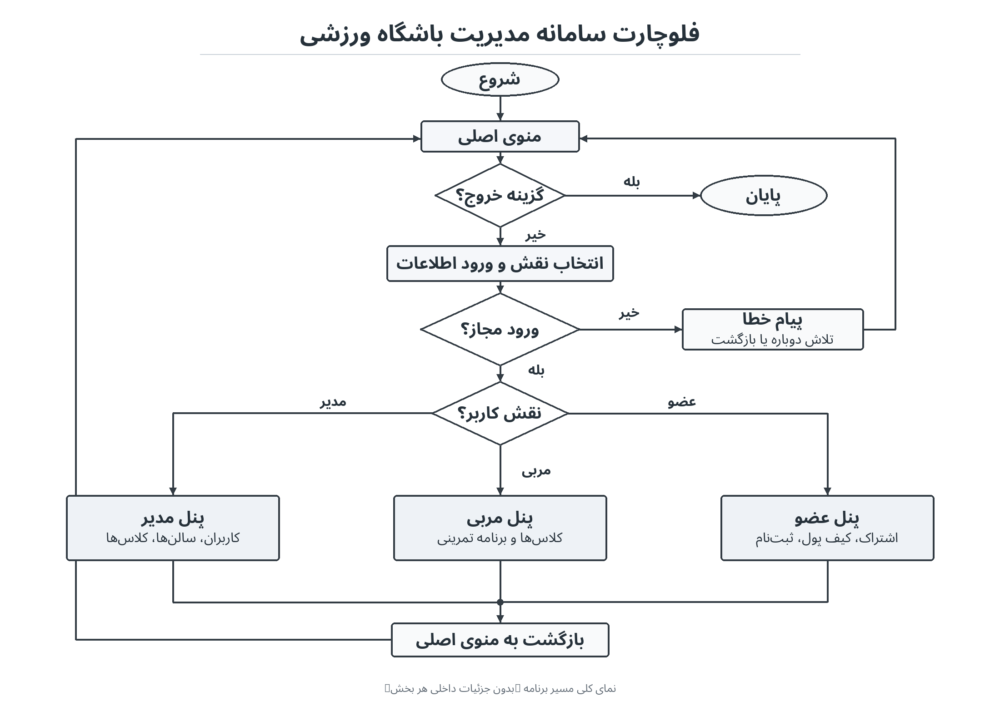

# Gym Management System

A Python-based Command-Line Interface (CLI) application for managing gym operations, users, classes, memberships, and payments.

**Final Project — Python Alpha Mini-Bootcamp (QBC13)**

## Overview

Gym Management System is an educational Python application designed to manage the daily operations of a fitness center.

The system supports three user roles:

- **Manager:** Manages users, halls, classes, subscriptions, and reports.
- **Coach:** Manages assigned classes and members' workout plans.
- **Member:** Manages subscriptions, wallet balance, class enrollment, and workout information.

The project demonstrates object-oriented programming, file handling, input validation, exception handling, decorators, generators, automated testing, and collaborative development with Git and GitHub.

Data is stored locally in UTF-8 text files.

## Features

### Manager Panel

The manager can:

- Add, view, and edit coach and member accounts.
- Activate or deactivate user accounts.
- Create, view, edit, and manage gym halls.
- Manage hall capacity and equipment.
- Create, view, edit, and manage gym classes.
- Validate coach and hall availability when managing classes.
- Monitor class capacity.
- View statistics for active members, coaches, and classes.
- Generate subscription revenue reports.
- View member subscription and payment information.
- Register or renew member subscriptions using the member's wallet balance, with manager confirmation.

### Coach Panel

Coaches can:

- View their assigned classes.
- View members enrolled in their classes.
- Create or update workout plans for their members.
- Manage workout details, including exercise names, sets, repetitions, rest periods, and optional notes.

### Member Panel

Members can:

- View their profile and subscription status.
- Check wallet balance and transaction history.
- Add funds through the project's simulated banking interface.
- Purchase or renew subscriptions using their wallet balance.
- View available classes and remaining capacity.
- Enroll in or withdraw from classes.
- View enrolled classes and assigned workout plans.

### Shared Functionality

- Role-based authentication.
- Username and password validation.
- Account activation checks.
- Activity logging using a Python decorator.
- File-based data persistence.
- Input validation and exception handling.
- Generator-based data processing.

## Technologies

- **Python 3.12+**
- **Object-Oriented Programming (OOP)**
- **Python Standard Library**
- **pytest**
- **Git & GitHub**
- **Text-file storage**

The application does not require a database server.

## Getting Started

### 1. Clone the Repository

```bash
git clone https://github.com/PaixDorm/Gym-Managment-System.git
cd Gym-Managment-System
```

Alternatively, download the repository as a ZIP file and extract it.

### 2. Install Dependencies

Make sure Python 3.12 or newer is installed.

Install the dependencies listed in `requirements.txt`:

```bash
python -m pip install -r requirements.txt
```

The main application primarily uses Python's standard library. The requirements file includes `pytest` for automated testing.

### 3. Create the Initial Manager Account

Before running the application for the first time, create a manager account:

```bash
python setup_manager.py
```

Follow the prompts to provide:

- Full name
- Username
- Email address
- Password

The application validates the information and saves the manager account locally.

Only one manager account is supported by the initial setup process.

After signing in as the manager, you can create coach and member accounts from the manager panel.

**Input requirements:**

- Usernames must contain at least three characters and may include English letters, numbers, and underscores.
- Passwords must contain at least one English letter, one number, and either `@` or `&`.
- Email addresses must follow a valid email format.

### 4. Run the Application

From the project root directory, run:

```bash
python main.py
```

The main menu provides four options:

```text
1. Manager Login
2. Coach Login
3. Member Login
4. Exit
```

After successful authentication, the application opens the appropriate panel for the user's role.

**Important:** Run the commands from the project root directory because some data files use relative paths.

## Project Structure

```text
Gym-Managment-System/
├── main.py
├── setup_manager.py
├── Bank.py
├── requirements.txt
├── README.md
├── LICENSE
├── data/
├── docs/
│   └── flowchart/
│       └── system_flowchart.png
├── src/
│   ├── admin/
│   ├── auth/
│   ├── coach/
│   ├── member/
│   ├── models/
│   ├── storage/
│   ├── logging/
│   ├── validation/
│   ├── generators/
│   └── utils/
└── tests/
```

### Main Components

| Component | Description |
|---|---|
| `main.py` | Main application menu and role-based navigation |
| `setup_manager.py` | Initial manager account setup |
| `Bank.py` | Educational banking simulation |
| `src/admin/` | User, hall, class, subscription, and report management |
| `src/auth/` | Authentication |
| `src/coach/` | Coach panel and workout management |
| `src/member/` | Member panel, enrollment, wallet, and subscriptions |
| `src/models/` | Data models |
| `src/storage/` | File storage utilities |
| `src/logging/` | Activity logging |
| `src/validation/` | Input validation |
| `src/generators/` | Generator-based utilities |
| `src/utils/` | Shared helper functions |
| `data/` | Local application data |
| `tests/` | Automated tests |

## Data Storage

The application uses text files to store information such as:

- User accounts
- Gym halls
- Classes
- Enrollments
- Workout plans
- Wallet transactions
- Subscriptions
- Activity logs

Some data files are created automatically when the related features are used.

Local files may contain sensitive information and should not be committed to a public repository with real user data.

## System Flowchart

The following flowchart illustrates the application's main navigation and role-based structure.



## Testing

The project includes automated tests for major components, including:

- Authentication
- User management
- Hall and class management
- Enrollment
- Workout management
- Wallet and transactions
- Subscriptions
- Reports
- Storage and logging
- Menu integration

Run the complete test suite with:

```bash
python -m pytest -q
```

You can also run the authentication tests separately:

```bash
python -m unittest tests/test_auth.py
```

**Latest local test result: 221 tests passed.**

Automated tests help verify functionality but do not guarantee that every possible scenario is error-free.

## Team & Contributions

This project was developed collaboratively by five team members as part of the Python Alpha QBC13 final project.

| Team Member | Main Contributions |
|---|---|
| **Amir** | Team leadership, project structure, main application, authentication, shared storage, logging, helper utilities, and integration |
| **Fatemeh** | User models, user management, and validation |
| **Atefeh** | Hall management, class management, related storage, and generators |
| **Arian J** | Wallet, transactions, subscriptions, and simulated payments |
| **Arian G** | Coach and member panels, class enrollment, workout management, and related reports |

The project was developed through feature-based collaboration using Git and GitHub.

## Security Notes & Limitations

**This is an educational project and is not intended for production use.**

Please consider the following limitations:

- User passwords are currently stored in plain text rather than securely hashed.
- Do not use real passwords or sensitive personal information.
- The banking interface in `Bank.py` is a simulation and does not connect to a real payment gateway.
- Do not enter real banking or payment-card information.
- Text-file storage is suitable for learning purposes but is not designed for production-level concurrency or reliability.
- Additional security measures, stronger authentication, and a database would be required for real-world deployment.

## License

This project is licensed under the **MIT License**.

See the [LICENSE](LICENSE) file for details.